# Writing Assistant ✍️

[](https://openjdk.org/)
[](https://openjfx.io/)
[](https://github.com/kordamp/bootstrapfx)
[](https://www.sqlite.org/)
[](https://poi.apache.org/)
[](https://ai.google.dev/)
[](https://junit.org/junit5/)
[]()

An academic and professional desktop writing assistant engineered in **Java 17** with **JavaFX + BootstrapFX**, **SQLite**, and **Apache POI**. Writing Assistant bridges the gap between AI-assisted drafting and strict academic integrity by offering intelligent style rewriting, citation-safe quote paraphrasing, and a **100% offline paraphrase-similarity safeguard**.

---

## 🎯 The Problem Solved

### The Problem in Academic & Professional Writing
1. **Unintentional Patchwriting & Academic Misconduct**: Writers frequently attempt to paraphrase external research by swapping individual words with synonyms while preserving the original author's sentence structure. Academic institutions classify this as *patchwriting* or mosaic plagiarism.
2. **Citation Formatting Inconsistencies**: Applying formatting rules across APA 7th, MLA 9th, and Chicago 17th author-date editions (in-text parentheticals, multi-author "et al." rules, title italics, and 0.5-inch hanging indents) is tedious and prone to human error.
3. **Loss of Session State & Rewrite Audit History**: Lightweight text editors lack structured persistence for citation metadata, document bibliographies, and an audit log of what was rewritten, why, and which alternative was chosen.
4. **Cloud Privacy & Vendor Lock-in**: Most similarity detection tools require uploading entire proprietary manuscripts to remote cloud servers, violating non-disclosure agreements or confidentiality requirements.

### The Solution Provided by Writing Assistant
Writing Assistant delivers a privacy-first, offline-capable desktop environment with ethical boundaries between authorial style refinement and external source attribution:

- **AI Style Rewriter (Phase 1)**: Operates strictly on the author's *own* writing across 5 specialized modes (**Tighten**, **Clarity**, **Formal**, **Casual**, **Grammar Fix**) with 1-click editor replacement and SQLite audit logging.
- **Citation-Safe Quote Paraphraser (Phase 2)**: Paraphrases external source quotes using prompts explicitly instructed to restructure clauses and reorganize ideas rather than swap synonyms, while automatically appending formatted in-text citations.
- **100% Offline Paraphrase-Similarity Safeguard (Phase 3)**: A deterministic, local algorithm that evaluates candidate text against source quotes using **Word N-Grams ($n=2,3,4$)**, **Longest Common Subsequence (LCS)**, and **Levenshtein Edit Distance**, highlighting verbatim overlapping spans with character-level accuracy.
- **Relational Persistence (Data Layer)**: An embedded SQLite database managing documents, citation libraries, per-document bibliography links, and rewrite audit logs.
- **Academic POI Word Export (Phase 4)**: Direct export to Microsoft Word (`.docx`) with parsed italic publication titles and 0.5-inch hanging indent reference lists.

---

## 🏗️ Application Architecture

Writing Assistant is built on a clean, decoupled 5-tier architecture:

```mermaid
graph TD
    subgraph UI_Layer ["Presentation Layer (JavaFX + BootstrapFX)"]
        UI_App["WritingAssistantApp / Main.java"]
        UI_Main["MainController (FXML)"]
        UI_ParaDlg["ParaphraseDialog (Wizard Modal)"]
        UI_SetDlg["SettingsDialog (Preferences Modal)"]
    end

    subgraph Core_Engines ["Core Business Engines (com.writingassistant.core)"]
        subgraph Rewrite_Module ["Phase 1: Style Rewriter"]
            RE_Engine["DefaultRewriteEngine"]
            RE_Prompts["RewritePromptTemplates"]
            RE_Parser["RewriteResponseParser"]
            RE_Cache["RewriteCache (Memory / SQLite)"]
        end

        subgraph Citation_Module ["Phase 2: Citation & Paraphrase"]
            CE_Engine["DefaultCitationEngine"]
            CE_Para["QuoteParaphraser"]
            CE_Formatter["CitationFormatter (APA/MLA/Chicago)"]
        end

        subgraph Similarity_Module ["Phase 3: Local Similarity Safeguard"]
            SE_Engine["DefaultSimilarityChecker"]
            SE_Tokenizer["Tokenizer & N-Gram (2/3/4)"]
            SE_LCS["Word LCS Calculator"]
            SE_Lev["Levenshtein Distance"]
            SE_Spans["MatchedSpan Extractor"]
        end
    end

    subgraph Data_Layer ["Persistence Layer (com.writingassistant.data)"]
        DB_Manager["DatabaseManager (SQLite WAL)"]
        DAO_Doc["SqliteDocumentDao (Documents & History)"]
        DAO_Cit["CitationLibrary (Search & Bibliography)"]
        POI_Service["DocxService (Apache POI Word Export)"]
    end

    subgraph Infrastructure_Layer ["Infrastructure & AI Integration"]
        AI_Client["GeminiClient (HTTP/2 Connection Pool)"]
        CFG_Manager["ConfigManager (~/.writing-assistant/config.json)"]
        LOG_Manager["AppLogger (Rotating 5MB File Handler)"]
    end

    UI_Main --> RE_Engine
    UI_Main --> CE_Engine
    UI_Main --> SE_Engine
    UI_Main --> DAO_Doc
    UI_Main --> DAO_Cit
    UI_Main --> POI_Service
    UI_Main --> UI_ParaDlg
    UI_Main --> UI_SetDlg

    RE_Engine --> AI_Client
    RE_Engine --> RE_Cache
    CE_Para --> AI_Client
    AI_Client --> CFG_Manager
    DAO_Doc --> DB_Manager
    DAO_Cit --> DB_Manager
```



### Package & Module Responsibilities

| Package | Key Classes | Responsibility |
| :--- | :--- | :--- |
| **`com.writingassistant`** | `Main.java` | Dual-mode launcher supporting JavaFX GUI launch and `--smoke-test` headless CLI diagnostics. |
| **`com.writingassistant.ai`** | `GeminiClient`, `AiResponse`, `GeminiStatus`, `AiFeatureUnavailableException` | Thin HTTP client communicating with Google Generative Language v1beta models with unconfigured key fallback. |
| **`com.writingassistant.config`** | `AppConfig`, `ConfigManager` | Cross-platform configuration management resolving `~/.writing-assistant` (macOS/Linux) or `%APPDATA%\WritingAssistant` (Windows). |
| **`com.writingassistant.core.rewrite`** | `DefaultRewriteEngine`, `RewritePromptTemplates`, `RewriteResponseParser`, `RewriteCache`, `RewriteMode` | 5-mode authorial style rewriting, prompt engineering, multi-pass regex parsing, and caching. |
| **`com.writingassistant.core.citation`** | `DefaultCitationEngine`, `QuoteParaphraser`, `CitationFormatter`, `SourceQuote`, `CitedParaphrase`, `CitationStyle` | Citation metadata models, anti-patchwriting quote paraphraser, and APA 7th, MLA 9th, Chicago 17th formatters. |
| **`com.writingassistant.core.similarity`** | `DefaultSimilarityChecker`, `SimilarityConfig`, `SimilarityReport`, `MatchedSpan`, `SimilarityRisk` | 100% offline similarity engine combining word n-grams ($n=2,3,4$), word LCS ratio, edit distance, and matched span extraction. |
| **`com.writingassistant.data`** | `DatabaseManager`, `SqliteDocumentDao`, `CitationLibrary`, `DocxService`, `DocumentRecord`, `RewriteHistoryEntry` | SQLite database manager with WAL mode, schema migrations, document DAO, citation library autocomplete, and Apache POI docx export. |
| **`com.writingassistant.logging`** | `AppLogger` | Rotating file logger (5 MB per file, max 5 backups) with automatic shutdown hook flushing. |
| **`com.writingassistant.ui`** | `WritingAssistantApp`, `MainController`, `ParaphraseDialog`, `SettingsDialog` | JavaFX views styled exclusively with BootstrapFX, dialogs, recent documents menu, and dynamic text highlighting. |

---

## 💻 Complete Technology Stack

| Technology | Category | Version | Role & Justification |
| :--- | :--- | :--- | :--- |
| **Java (OpenJDK)** | Language / Runtime | `17 LTS` | Modern language features: Records, Pattern Matching, `java.net.http.HttpClient`, and strict strong typing. |
| **OpenJFX (JavaFX)** | GUI Framework | `21.0.2` | High-performance, cross-platform native desktop UI rendering with FXML and reactive property bindings. |
| **BootstrapFX** | UI Design System | `0.4.0` | Professional Bootstrap CSS styling (`btn`, `panel`, `lbl`, `alert`, `h1`-`h6`) without custom CSS or HTML overhead. |
| **Apache POI (`poi-ooxml`)** | Document Processing | `5.2.5` | Reads and writes Microsoft Word (`.docx`) documents with paragraph formatting, italics, and 0.5-inch hanging indents. |
| **SQLite JDBC** | Embedded Database | `3.45.1.0` | Zero-configuration, ACID-compliant embedded database with Write-Ahead Logging (WAL) for multi-session persistence. |
| **Google Gson** | JSON Serialization | `2.10.1` | Serialization of configuration files and structured Gemini API JSON payloads. |
| **Google Gemini API** | AI Provider | `v1beta` | Generative language models (`gemini-1.5-flash`, `gemini-1.5-pro`, `gemini-2.0-flash`) for style rewriting and paraphrasing. |
| **JUnit 5 (Jupiter)** | Automated Testing | `5.10.2` | Comprehensive test suite covering unit tests, integration tests, and smoke tests across all application layers. |
| **Apache Maven** | Build Automation | `3.8+` | Dependency resolution, compilation, shaded executable packaging, and `jpackage` installer profiles. |

---

## 🗄️ Relational Database Schema (SQLite)

Writing Assistant initializes an embedded SQLite database (`writing_assistant.db`) with foreign keys and WAL mode:

```sql
-- Tracked working documents
CREATE TABLE IF NOT EXISTS documents (
    id TEXT PRIMARY KEY,
    title TEXT NOT NULL,
    file_path TEXT,
    created_at TIMESTAMP DEFAULT CURRENT_TIMESTAMP,
    last_opened TIMESTAMP DEFAULT CURRENT_TIMESTAMP
);

-- Reusable global citation library
CREATE TABLE IF NOT EXISTS citation_library (
    id TEXT PRIMARY KEY,
    author TEXT NOT NULL,
    year TEXT,
    title TEXT NOT NULL,
    container TEXT,
    page_number TEXT,
    url_or_doi TEXT,
    source_type TEXT NOT NULL,
    style_preference TEXT DEFAULT 'APA',
    created_at TIMESTAMP DEFAULT CURRENT_TIMESTAMP
);

-- Many-to-many document to citation linking for bibliographies
CREATE TABLE IF NOT EXISTS document_citations (
    document_id TEXT NOT NULL,
    citation_id TEXT NOT NULL,
    created_at TIMESTAMP DEFAULT CURRENT_TIMESTAMP,
    PRIMARY KEY (document_id, citation_id),
    FOREIGN KEY (document_id) REFERENCES documents(id) ON DELETE CASCADE,
    FOREIGN KEY (citation_id) REFERENCES citation_library(id) ON DELETE CASCADE
);

-- Full audit log of accepted AI rewrites
CREATE TABLE IF NOT EXISTS rewrite_history (
    id TEXT PRIMARY KEY,
    document_id TEXT,
    original_text TEXT NOT NULL,
    chosen_mode TEXT NOT NULL,
    chosen_alternative TEXT NOT NULL,
    created_at TIMESTAMP DEFAULT CURRENT_TIMESTAMP,
    FOREIGN KEY (document_id) REFERENCES documents(id) ON DELETE SET NULL
);
```

---

## 🔍 Local Similarity Checker Mechanics

The local similarity checker operates **100% offline** using a multi-signal heuristic formula:

$$\text{Composite Score} = (0.35 \times \text{N-Gram}) + (0.40 \times \text{LCS Ratio}) + (0.25 \times \text{Levenshtein})$$

1. **Word N-Gram Overlap ($n=2,3,4$) (Weight: 35%)**: Measures shared sequences of consecutive words between the candidate paraphrase and source quote. High shared n-grams indicate that sentence structure was retained.
2. **Word Longest Common Subsequence (LCS) Ratio (Weight: 40%)**: Calculates the length of the longest ordered sequence of common words relative to the shorter text length, detecting unchanged contiguous thought progressions.
3. **Sentence-Level Levenshtein Edit Distance (Weight: 25%)**: Measures character edit distance normalized against text length to capture phrase-level surface similarities.
4. **Verbatim Span Extractor**: Pinpoints exact character offsets `[startIndex, endIndex]` for any shared word sequences $\ge 3$ words, rendering underlined highlights in the UI.

### Calibrated Risk Classification
- 🟢 **LOW RISK** (<25%): Substantially restructured with minimal textual overlap.
- 🟡 **MODERATE RISK** (25%–55%): Shared phrasing or sequence structure detected; further restructuring recommended.
- 🔴 **HIGH RISK** (>55%): Verbatim overlap or structural mirroring detected; direct quotation or thorough rewrite needed.

---

## 🚀 Getting Started

### Prerequisites
- **Java Development Kit (JDK) 17** or higher.
- **Apache Maven 3.8+**.
- *(Optional)* A Google Gemini API key for AI features. (Offline similarity checking, persistence, and docx export work without an API key).

### Installation & Quickstart

```bash
# 1. Clone the repository
git clone https://github.com/SadeeshaJayaweera/originality-desk.git
cd originality-desk

# 2. Run the automated test suite (57 tests)
mvn clean test

# 3. Launch the desktop GUI via Maven
mvn javafx:run

# 4. Or build the standalone executable Fat JAR
mvn clean package

# 5. Launch the standalone Fat JAR
java -jar target/writing-assistant-1.0.0-SNAPSHOT.jar

# 6. Run headless CLI diagnostics & smoke test
java -jar target/writing-assistant-1.0.0-SNAPSHOT.jar --smoke-test
```

---

## 📦 Native Desktop Installers (`jpackage`)

Writing Assistant includes Maven packaging profiles to create native, zero-dependency desktop installers with an embedded Java runtime:

### macOS (`.dmg`)
```bash
mvn clean package -Ppackage-mac
```
*Manual CLI command:*
```bash
jpackage --type dmg \
  --name WritingAssistant \
  --input target \
  --main-jar writing-assistant-1.0.0-SNAPSHOT.jar \
  --main-class com.writingassistant.Main \
  --app-version 1.0.0 \
  --icon src/main/resources/com/writingassistant/ui/icons/app-icon.png \
  --dest target/dist
```

### Windows (`.msi` / `.exe`)
```bash
mvn clean package -Ppackage-win
```
*Manual CLI command:*
```bash
jpackage --type msi \
  --name WritingAssistant \
  --input target \
  --main-jar writing-assistant-1.0.0-SNAPSHOT.jar \
  --main-class com.writingassistant.Main \
  --app-version 1.0.0 \
  --win-dir-chooser \
  --win-menu \
  --win-shortcut \
  --dest target/dist
```

### Linux (`.deb`)
```bash
mvn clean package -Ppackage-linux
```
*Manual CLI command:*
```bash
jpackage --type deb \
  --name writing-assistant \
  --input target \
  --main-jar writing-assistant-1.0.0-SNAPSHOT.jar \
  --main-class com.writingassistant.Main \
  --app-version 1.0.0 \
  --linux-shortcut \
  --dest target/dist
```

---

## 🧪 Testing & Quality Assurance

Writing Assistant is thoroughly tested with **57 passing automated tests** across all architectural layers:
- **Unit Tests**: `ConfigManagerTest`, `GeminiConnectivityTest`, `RewriteResponseParserTest`, `CitationFormatterTest`, `DefaultSimilarityCheckerTest`, `DocxServiceTest`, `DatabaseManagerTest`, `SqliteDocumentDaoTest`, `CitationLibraryTest`, `AppLoggerTest`.
- **Smoke Tests**: `RewriteSmokeTest`, `CitationSmokeTest`, `SimilaritySmokeTest`, `SessionPersistenceSmokeTest`.
- **Integration Tests**: `EndToEndWorkflowTest` (executes the complete open $\rightarrow$ rewrite $\rightarrow$ paraphrase $\rightarrow$ similarity $\rightarrow$ export lifecycle).
- **Manual Verification**: See [TESTING.md](file:///Users/macboookpro/originality-desk/TESTING.md) for step-by-step test scenarios for style modes, citation styles, and offline recovery.

---

## ⚖️ Known Limitations & Ethical Disclaimer

> [!IMPORTANT]
> **Authoring Aid vs. Plagiarism Detection Disclaimer**:
> 1. **Educational Authoring Aid**: The local similarity checker uses deterministic textual overlap heuristics (word n-grams, longest common subsequences, edit distance). It is designed to assist authors in identifying unintentional patchwriting and ensuring structural reorganization.
> 2. **Not a Plagiarism Evasion Tool**: The tool is **not** designed to bypass or guarantee passing third-party plagiarism detection services (e.g., Turnitin, SafeAssign, Copyleaks), which rely on proprietary web crawlers, institutional repositories, and semantic vector embeddings.
> 3. **Offline Scope**: Local similarity checking, SQLite persistence, citation formatting, and Word export work 100% offline. AI style rewriting and paraphrasing require an active internet connection and a configured Gemini API key.

---

## 📄 License & Attribution

Developed by **Sadeesha Jayaweera** (`sadeesha.jayaweera@gmail.com`).  
Licensed under the [MIT License](LICENSE).
