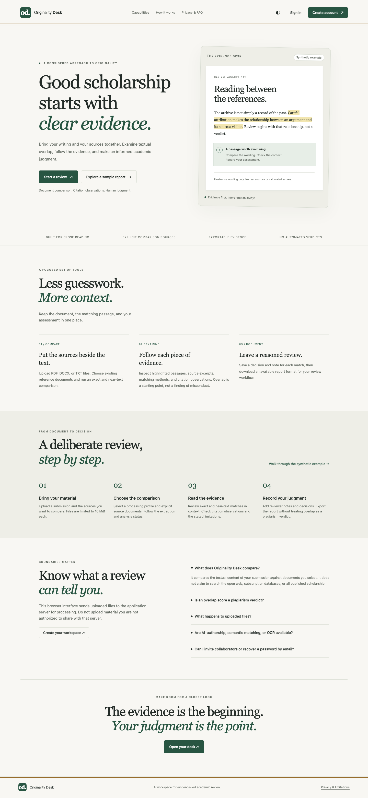
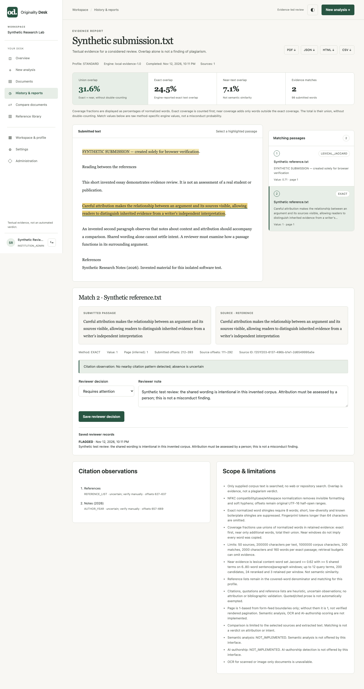
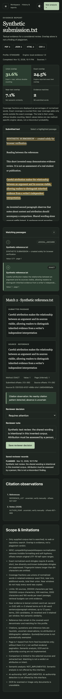
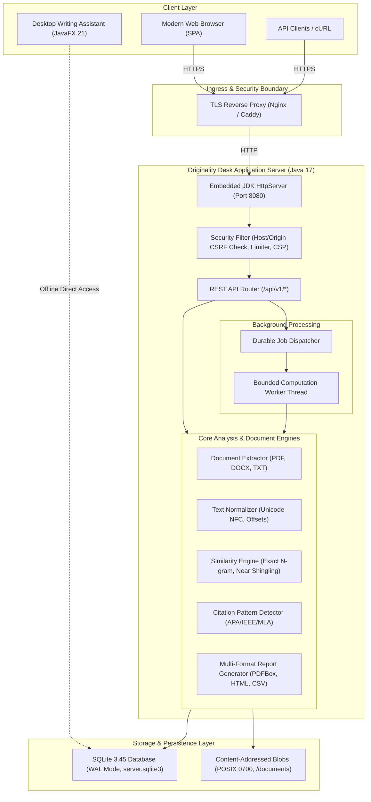
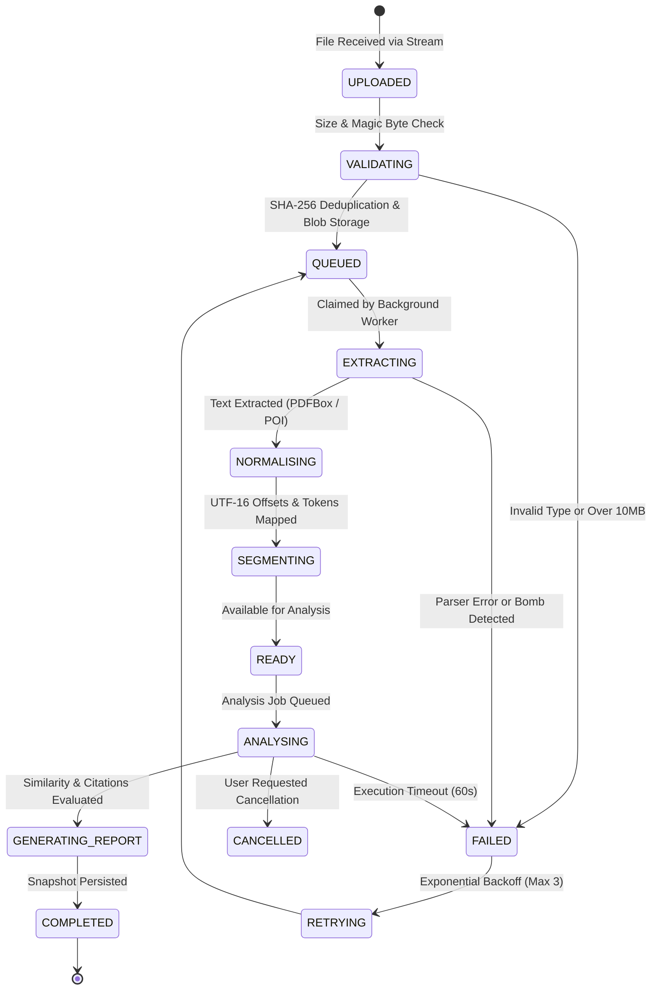
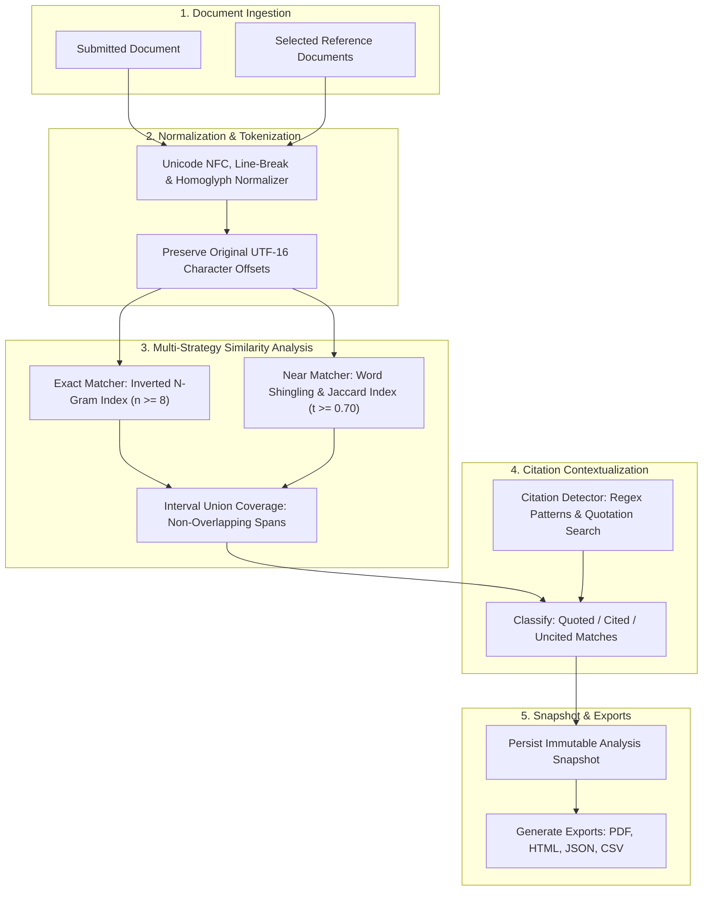
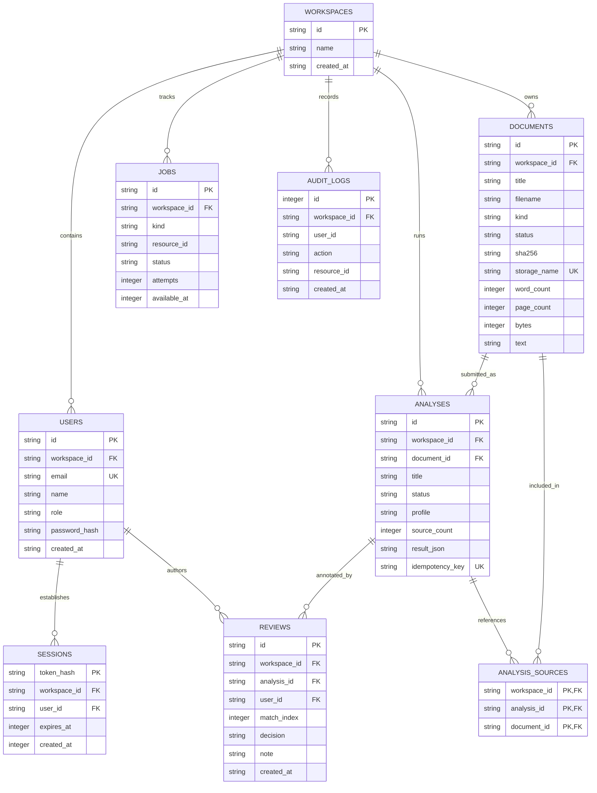
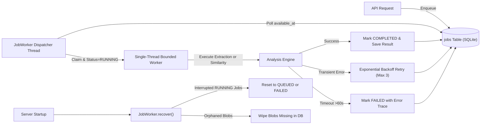

# Originality Desk 🔍

[](https://openjdk.org/)
[](https://www.sqlite.org/)
[](https://pdfbox.apache.org/)
[](https://poi.apache.org/)
[](https://www.docker.com/)
[](LICENSE)
[]()

An evidence-based academic document originality, similarity detection, and citation analysis platform. Built in **Java 17** with a zero-external-dependency embedded server, a deterministic multi-strategy similarity engine, and an accessible, responsive browser workspace.

Originality Desk bridges the gap between mechanical similarity scores and genuine academic integrity review by providing transparent, reproducible passage-level evidence, citation context analysis, human reviewer decision workflows, and multi-format report exports (PDF, HTML, JSON, CSV).

The repository also preserves the original **Desktop Writing Assistant** (JavaFX + BootstrapFX) for offline authorial drafting, style rewriting, and citation formatting.

---

## 📸 Screenshots

Captured from the live application serving synthetic test corpora in Chromium:

| Public Landing Page | Evidence-Led Analysis Report | Mobile Viewport (Dark Theme) |
|---|---|---|
| [](docs/screenshots/landing.png) | [](docs/screenshots/report.png) | [](docs/screenshots/mobile.png) |
| *Responsive landing page with feature explanations and interactive demonstration.* | *Traceable side-by-side passage comparison, citation observations, and human reviewer notes.* | *Persisted dark theme, keyboard-accessible navigation on a 390 × 844 viewport.* |

*See [docs/screenshots/README.md](docs/screenshots/README.md) for observed test execution metrics and capture digests.*

---

## 🎯 The Problem & Our Solution

### The Problem in Academic Integrity Review
1. **Opaque "Similarity Percentages"**: Commercial plagiarism detection tools return a single, unexplainable percentage score without distinguishing between verbatim copying, legitimate citations, common academic phrasing, or bibliography lists.
2. **Fabricated & Unreliable AI Detectors**: Heuristic AI detectors generate alarming false-positive rates on non-native English writing and formal academic prose, frequently leading to unjust accusations of misconduct.
3. **Data Privacy & Surveillance Concerns**: Uploading confidential academic manuscripts, patent applications, or grant proposals to third-party cloud servers risks intellectual property leaks and breaches non-disclosure agreements.
4. **Patchwriting & Synonym Substitution**: Superficial word-swapping tools bypass simple exact-string checks while retaining the original author's structural sequence.

### The Solution Provided by Originality Desk
- **Evidence-First Transparency**: Similarity is reported as verifiable passage-level evidence pointing to explicit, authorized reference documents.
- **Independent Metric Decomposition**: Distinct metrics for **Exact Matches**, **Near-Duplicate Paraphrasing**, **Quoted Passages**, and **Bibliography Overlap** using interval union mathematics that prevents double-counting.
- **Citation-Aware Context**: Automatic detection of standard academic citation styles (APA, IEEE, MLA, Harvard, Vancouver) adjacent to matching passages.
- **Human Reviewer Decisions**: Tools for lecturers and supervisors to mark passages as acceptable citations, missing attributions, or confirmed quotations with persistent reviewer notes.
- **100% Offline-First Privacy**: The core similarity detection engine runs completely in-process. Documents are never transmitted to third-party AI APIs or external web crawlers.

---

## 🏗️ System Architecture & Workflows

### 1. Overall System Architecture



---

### 2. Document Processing Lifecycle



---

### 3. Similarity Analysis Pipeline



---

### 4. Authentication & Workspace Authorization

```mermaid
sequenceDiagram
    autonumber
    actor User as User / Browser
    participant Svr as Originality Desk Server
    participant DB as SQLite Relational Database

    User->>Svr: POST /api/v1/auth/register (name, email, password, workspace)
    Note over Svr: PBKDF2-HMAC-SHA256 (210,000 iterations)
    Svr->>DB: INSERT into workspaces, users (Role: INSTITUTION_ADMIN)
    Note over Svr: Generate 256-bit cryptographically secure token
    Svr->>DB: INSERT into sessions (SHA-256 token_hash, 12h expiry)
    Svr-->>User: 201 Created (Set-Cookie: desk_session=...; HttpOnly; SameSite=Strict)

    User->>Svr: POST /api/v1/documents (with Origin header & desk_session cookie)
    Note over Svr: Validate Host authority & Origin == publicOrigin (Anti-CSRF)
    Svr->>DB: SELECT workspace_id, role FROM sessions JOIN users
    Note over Svr: Derive workspace_id strictly from session
    Svr->>DB: INSERT INTO documents WHERE workspace_id = ?
    Svr-->>User: 201 Created (Document Metadata)
```

---

### 5. Relational Database Entity-Relationship Diagram



---

### 6. Background Job Worker & Failure Recovery



---

## 💻 Technology Stack

| Component | Technology | Rationale |
|---|---|---|
| **Programming Language** | Java 17 LTS (compile target 17) | Strict memory safety, cross-platform portability, high throughput |
| **HTTP Server** | JDK `HttpServer` (Java Standard Library) | Zero external web framework dependencies, minimal attack surface |
| **Database & Persistence** | SQLite 3.45 via `sqlite-jdbc` | Full transactional ACID safety, WAL mode, zero configuration |
| **PDF Extraction & Export** | Apache PDFBox 3.0.5 | Native vector PDF generation and bounded text extraction |
| **DOCX Processing** | Apache POI 5.2.5 | Reliable Office Open XML extraction with decompression protection |
| **JSON Serialization** | Google Gson 2.10.1 | Fast, strict JSON binding for configurations, APIs, and snapshots |
| **Frontend Architecture** | Vanilla HTML5, CSS3, JavaScript (ES6) | Zero npm runtime dependencies, fast loading, full keyboard accessibility |
| **Desktop GUI** | JavaFX 21 + BootstrapFX 0.4.0 | Preserved desktop authoring tool for offline writing and citation styling |
| **Test Automation** | JUnit 5 + Node Test Runner + Python | Multi-tier validation spanning unit, API, markup, and benchmark suites |

---

## 🚀 Quick Start & Local Setup

### Prerequisites
- **Java 17+** (Eclipse Temurin or OpenJDK recommended)
- **Apache Maven 3.9+**
- **Node.js 20+** (optional, for frontend unit tests)
- **Python 3.10+** (optional, for evaluation benchmark)

### 1. Build the Application
```sh
# Clone repository
git clone https://github.com/SadeeshaJayaweera/originality-desk.git
cd originality-desk

# Build shaded executable JAR
mvn clean package -DskipTests
```

### 2. Launch Originality Desk Web Server
```sh
# Run the standalone web server
java -jar target/writing-assistant-1.0.0-SNAPSHOT.jar --server

# Or run directly via class name:
java -cp target/writing-assistant-1.0.0-SNAPSHOT.jar com.writingassistant.server.OriginalityDeskServer
```

Navigate to: **[http://localhost:8080](http://localhost:8080)**  
Click **Create workspace** to initialize your institution administrator account.

### 3. Launch Preserved Desktop GUI
```sh
# Run the JavaFX desktop writing assistant
java -jar target/writing-assistant-1.0.0-SNAPSHOT.jar
```

*For complete setup options, see [docs/LOCAL_SETUP.md](docs/LOCAL_SETUP.md).*

---

## 🐳 Docker Deployment

Run Originality Desk with Docker Compose:

```sh
# Copy environment template
cp .env.example .env

# Build and start container in detached mode
docker compose up -d

# Check service health
curl -f http://localhost:8080/health/live
```

*See [docs/PRODUCTION_DEPLOYMENT.md](docs/PRODUCTION_DEPLOYMENT.md) for Nginx configuration, TLS termination, and systemd service setups.*

---

## ⚙️ Environment Variables

| Variable | Default | Purpose |
|---|---|---|
| `DESK_HOST` | `127.0.0.1` | Network interface address to bind to (`0.0.0.0` in Docker). |
| `DESK_PORT` | `8080` | Port for the HTTP server. |
| `DESK_PUBLIC_ORIGIN` | `http://localhost:8080` | Canonical browser origin. Required for Host and CSRF Origin validation. |
| `DESK_DATA_DIR` | `./desk-server-data` | Directory storing SQLite database, WAL files, and document blobs. |
| `DESK_SECURE_COOKIES`| `false` | Set to `true` in production to enforce HTTPS cookie flag. |
| `DESK_RETENTION_DAYS` | `0` | Automatic document retention limit in days (0 = retain indefinitely). |
| `DESK_JOB_TIMEOUT_SECONDS` | `60` | Bounded execution deadline per background job. |

*Detailed reference in [docs/ENVIRONMENT_VARIABLES.md](docs/ENVIRONMENT_VARIABLES.md).*

---

## 🧪 Test Execution & Verification

Run the comprehensive multi-tier test suites:

```sh
# 1. Run all Java unit and integration tests (154 tests)
mvn test

# 2. Run JavaScript frontend and markup tests (16 tests)
node scripts/e2e/fixtures.test.cjs
node scripts/e2e/markup.test.cjs
node src/main/resources/web/frontend.test.cjs

# 3. Verify synthetic evaluation benchmark (32 cases, 2,880 timed calls)
python3 scripts/evaluation/run.py --verify-only scripts/evaluation/results
```

*Detailed verification summary in [docs/IMPLEMENTATION_COMPLETION_REPORT.md](docs/IMPLEMENTATION_COMPLETION_REPORT.md).*

---

## 📡 REST API Reference

The server exposes a clean REST API under `/api/v1/*`. All mutating requests require authentication and strict `Origin` validation.

| Endpoint | Method | Role | Description |
|---|---|---|---|
| `/health/live` | `GET` | Public | Liveness probe returning server status. |
| `/health/ready` | `GET` | Public | Readiness probe checking database & job worker. |
| `/api/v1/auth/register` | `POST` | Public | Register new user and workspace (creates `INSTITUTION_ADMIN`). |
| `/api/v1/auth/login` | `POST` | Public | Authenticate user and issue opaque session cookie. |
| `/api/v1/auth/me` | `GET` | Member | Retrieve current user profile and workspace metadata. |
| `/api/v1/auth/logout` | `POST` | Member | Invalidate current session. |
| `/api/v1/dashboard` | `GET` | Member | Retrieve workspace metrics, recent analyses, and storage stats. |
| `/api/v1/documents` | `GET` | Member | List workspace documents with status and pagination. |
| `/api/v1/documents` | `POST` | Member | Stream raw file upload (PDF, DOCX, TXT; 10MB max). |
| `/api/v1/documents/:id` | `GET` | Member | Get document status, metadata, and extracted text. |
| `/api/v1/documents/:id` | `DELETE`| Member | Securely delete document and all dependent analyses. |
| `/api/v1/analyses` | `GET` | Member | List analyses with status and pagination. |
| `/api/v1/analyses` | `POST` | Member | Submit new similarity analysis with profile & source IDs. |
| `/api/v1/analyses/:id` | `GET` | Member | Retrieve analysis result snapshot with passage matches. |
| `/api/v1/analyses/:id/cancel` | `POST` | Member | Cancel a queued or running analysis. |
| `/api/v1/analyses/:id/reviews`| `GET/POST` | Reviewer | Retrieve or record human reviewer decisions and notes. |
| `/api/v1/reports/:id/json` | `GET` | Member | Download complete evidence report as JSON. |
| `/api/v1/reports/:id/html` | `GET` | Member | Download standalone interactive HTML report. |
| `/api/v1/reports/:id/csv` | `GET` | Member | Download passage evidence rows as CSV. |
| `/api/v1/reports/:id/pdf` | `GET` | Member | Download publication-grade vector PDF report. |
| `/api/v1/admin/health` | `GET` | Admin | Inspect operational metrics, memory, and queue depth. |
| `/api/v1/admin/jobs` | `GET` | Admin | Paginated list of background extraction and analysis jobs. |
| `/api/v1/admin/audit-logs` | `GET` | Admin | Paginated audit trail of workspace security actions. |

*Full API contract and OpenAPI specification in [docs/API.md](docs/API.md) and [docs/openapi.yaml](docs/openapi.yaml).*

---

## 🔒 Security Architecture

- **Tenant Isolation**: Every database operation is constrained by the server-derived `workspace_id`. Cross-tenant queries return 404.
- **CSRF Defense**: Zero CORS support; all state-changing API operations strictly enforce `Origin == DESK_PUBLIC_ORIGIN` and `Sec-Fetch-Site: same-origin`.
- **Password Security**: PBKDF2-HMAC-SHA256 with 210,000 iterations and individual 16-byte random salts.
- **Session Protection**: Host-only, `HttpOnly`, `SameSite=Strict` cookies containing random 256-bit tokens, stored only as SHA-256 hashes.
- **Input Validation**: Magic byte file validation, ZIP decompression bomb protection (`SafeZip`), 10 MiB upload cap, strict UTF-8 JSON parsing.
- **Secure Data Erasure**: SQLite configured with `PRAGMA secure_delete=ON`, zero-filling deleted table pages; blobs wiped immediately on deletion.

*Complete security review in [docs/SECURITY_REVIEW.md](docs/SECURITY_REVIEW.md).*

---

## ⚠️ Known Limitations & Disclaimers

1. **Source Scope**: Originality Desk compares submissions **strictly against authorized reference documents uploaded to your workspace**. It does not crawl the open web, commercial subscription databases, or paywalled publishers.
2. **Text Similarity $\ne$ Academic Misconduct**: High similarity scores do not prove plagiarism; low scores do not prove originality. Matches require human review to evaluate disciplinary context, quotations, and field conventions.
3. **AI Writing Detection**: In adherence to scientific rigor, the platform refuses to manufacture unverified AI-authorship percentages. AI analysis status is honestly reported as `UNAVAILABLE` without a certified local classifier.
4. **Single-Node Architecture**: The server uses embedded SQLite with single-process file locking, designed for bounded departmental and institutional workloads (up to thousands of documents). Horizontal clustering requires migrating to PostgreSQL and distributed object storage.

---

## 🗺️ Engineering Roadmap

- [x] Standalone headless Java web server with REST API
- [x] Multi-tenant workspace isolation and role-based access control
- [x] Bounded PDF, DOCX, and TXT extraction with offset-preserving normalisation
- [x] Inverted N-Gram exact matching and shingled near-duplicate detection
- [x] Interval union coverage calculation (no double-counting)
- [x] Citation observation and reference pattern detection
- [x] Multi-format report generation (JSON, HTML, CSV, PDF)
- [x] Human reviewer decision and annotation workflow
- [x] Durable background job processing with crash recovery
- [x] Responsive browser frontend with dark/light themes
- [x] Dockerfile, Docker Compose, and CI/CD automation
- [x] Comprehensive documentation suite and synthetic evaluation benchmark
- [ ] Local semantic embeddings via ONNX Runtime / pgvector (Phase 2)
- [ ] Tesseract OCR native container integration for image-only PDFs (Phase 2)
- [ ] LTI 1.3 Advantage integration for Canvas, Moodle, and Blackboard (Phase 3)
- [ ] Enterprise SAML 2.0 / SCIM institutional directory sync (Phase 3)

---

## 📚 Supplementary Documentation

- 📖 **[Local Setup Guide](docs/LOCAL_SETUP.md)**: Developer prerequisites, building, running, and troubleshooting.
- 🚀 **[Production Deployment](docs/PRODUCTION_DEPLOYMENT.md)**: Systemd service, Nginx reverse proxy, and container setup.
- ⚙️ **[Environment Variables](docs/ENVIRONMENT_VARIABLES.md)**: Exhaustive reference for all configuration options.
- 💾 **[Backup and Recovery](docs/BACKUP_AND_RECOVERY.md)**: Online SQLite backup, WAL checkpoints, and disaster recovery.
- 🛠️ **[Operations Runbook](docs/OPERATIONS_RUNBOOK.md)**: Health probes, logging, troubleshooting, and maintenance.
- 📋 **[Implementation Completion Report](docs/IMPLEMENTATION_COMPLETION_REPORT.md)**: Detailed audit and verification matrix.
- 📊 **[Evaluation Methodology](docs/EVALUATION_METHODOLOGY.md)**: Synthetic benchmark design and confusion matrix formulas.
- 📈 **[Benchmark Results](docs/BENCHMARK_RESULTS.md)**: Measured accuracy and CPU latency on synthetic test suites.
- 🔐 **[Security Review](docs/SECURITY_REVIEW.md)**: Threat modeling, trust boundaries, and vulnerability mitigations.
- 📡 **[REST API Specification](docs/API.md)**: Complete HTTP route documentation and payload contracts.

---

## 📄 License

This project is licensed under the Apache License 2.0. See [LICENSE](LICENSE) for details.
