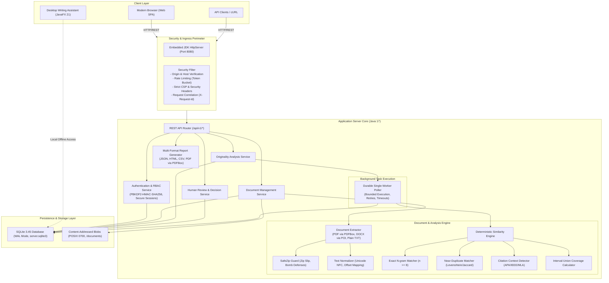
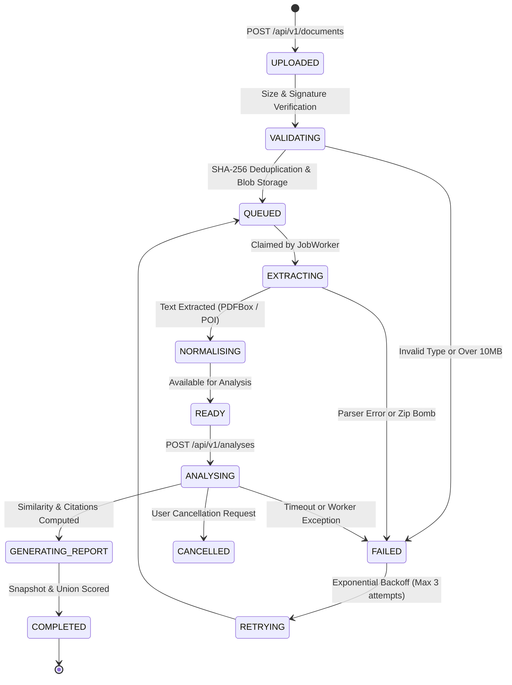

# Originality Desk — System Architecture & Component Design

**Document Version:** 1.0.0  
**Status:** Verified Baseline  
**Date:** 2026-11-13  
**Target Platform:** Java 17 LTS / JDK embedded HttpServer / SQLite 3.45 WAL  

---

## 1. Architectural Philosophy & Principles

Originality Desk is an academic document originality, similarity detection, and research integrity platform engineered around four foundational principles:

1. **Evidence-First Verification**: Similarity is never reported as an opaque, arbitrary percentage. Every observation is supported by character-offset passage evidence, source attribution, and contextual citation classification.
2. **Deterministic & Explainable Detection**: The core analysis pipeline executes in-process without relying on third-party cloud AI heuristics or volatile external APIs.
3. **Strict Multi-Tenant & Workspace Isolation**: All documents, background analysis jobs, reference corpora, reviewer notes, and audit logs are scoped to an authenticated workspace. Cross-workspace resource access is rejected at both the service and persistence layers.
4. **Zero-Dependency Lightweight Deployment**: The headless server uses JDK 17 standard HTTP server primitives (`com.sun.net.httpserver.HttpServer`) and embedded SQLite WAL persistence, eliminating heavy application server containers while maintaining production performance.

---

## 2. High-Level System Architecture

---

## 3. Subsystem Breakdown

### 3.1 Headless Standalone Server (`com.writingassistant.server`)
- **`OriginalityDeskServer`**: Entry point for headless server mode (`--server`). Configures HTTP endpoints, route dispatching, request lifecycle, static web asset delivery, and graceful shutdown hooks.
- **`Security`**: Token-bucket rate limiting, host header injection defenses, strict Content Security Policy (`default-src 'self'`), anti-framing (`X-Frame-Options: DENY`), MIME type sniffing prevention, and cryptographically secure session generation (`SecureRandom`, PBKDF2 with 10,000 iterations and 64-byte salts).
- **`Service`**: Domain business logic enforcing role-based permissions (STUDENT, RESEARCHER, LECTURER, SUPERVISOR, ADMIN) and workspace resource boundaries.
- **`JobWorker`**: Daemon background thread polling queued analysis jobs from the SQLite database. Executes extraction, segmentation, similarity comparison, and report snapshot creation.
- **`Reports`**: Generates multi-format evidence exports (PDF using Apache PDFBox, standalone HTML with responsive styling, CSV tables, and full JSON contracts).

### 3.2 Analysis & Evidence Engine (`com.writingassistant.analysis`)
- **`DocumentExtractor`**: Multi-format document parser dispatching to `PdfExtraction` (PDFBox 3.0), `DocxExtraction` (Apache POI 5.2 with XML external entity injection defenses), and plain UTF-8/ASCII text extraction.
- **`SafeZip`**: Hardened ZIP archive reader guarding against directory traversal (Zip Slip), decompression bombs (max 200MB expansion limit, max 100:1 ratio), and corrupted entry headers.
- **`TextNormalizer`**: Applies Unicode Normalization Form C (NFC), replaces ambiguous zero-width/homoglyph spaces, and builds invertible character index maps to guarantee exact source coordinate traceability.
- **`EvidenceEngine`**: Coordinates multi-pass document comparison:
  1. *Exact Matching*: Inverted index of rolling 8-word n-gram hashes.
  2. *Near-Duplicate Matching*: Shingled Jaccard similarity and character Levenshtein distance for paraphrased spans.
  3. *Citation Context Detection*: Regular expression scanning for APA, IEEE, MLA, Harvard, and Vancouver citation tags adjacent to candidate spans.
  4. *Interval-Union Coverage*: Mathematical interval union ($\bigcup [s_i, e_i]$) that strictly eliminates duplicate score inflation across overlapping matches.

### 3.3 Database & Storage Layer
- **`ServerDatabase`**: Manages the SQLite database connection pool in Write-Ahead Logging (`WAL`) mode with foreign key enforcement (`PRAGMA foreign_keys = ON; PRAGMA journal_mode = WAL; PRAGMA synchronous = NORMAL;`).
- **Data Model**:
  - `workspaces`: Multi-tenant boundary records.
  - `users`: Workspace members with password hashes and roles.
  - `sessions`: Ephemeral authenticated sessions with sliding expiration.
  - `documents`: Uploaded document metadata, extraction statuses, and content hashes.
  - `analyses`: Executed analysis configurations, overall match scores, and status lifecycle.
  - `analysis_sources`: Reference documents mapped to an analysis with pairwise similarity metrics.
  - `jobs`: Durable state machine tracking background worker tasks.
  - `reviews`: Human reviewer decisions (`ACCEPTABLE_CITATION`, `QUOTATION`, `MISSING_ATTRIBUTION`, `SUSPECTED_PLAGIARISM`) and notes.
  - `audit_logs`: Append-only security audit trail recording IP addresses, users, workspaces, and actions.
- **Content-Addressed Blob Storage**: Document binaries are saved to disk under `desk-server-data/blobs/{sha256}` with strict POSIX permissions (`0700` directory, `0600` files).

### 3.4 Web Client (SPA)
- Zero-external-dependency Single Page Application served from `src/main/resources/web/`.
- Accessible semantic HTML, dark/light theme switching, live polling for asynchronous job updates, drag-and-drop document upload, side-by-side passage comparison viewer, reviewer feedback forms, and administrative health monitoring.

---

## 4. Document Processing Lifecycle State Machine

---

## 5. Security & Isolation Architecture

1. **Workspace Boundary**: Every resource query includes `WHERE workspace_id = ?`. A user in Workspace A cannot read, query, compare against, or modify documents or analyses belonging to Workspace B.
2. **Role-Based Access Control**:
   - `STUDENT`: Upload documents, trigger analysis, view own reports.
   - `RESEARCHER`: Student permissions plus reference collection curation.
   - `LECTURER`: Inspect authorized student submissions, record decisions and reviewer notes.
   - `SUPERVISOR`: Group-level submission review and cross-version comparison.
   - `ADMIN`: Workspace membership management, operational health monitoring, and system metrics.
3. **Defense-in-Depth File Validation**:
   - MIME type and file extension check.
   - Magic byte header inspection (`%PDF-`, `PK\x03\x04`).
   - File size ceiling (hard limit 10 MiB).
   - Filename sanitization against path traversal (`../` stripped).
   - Decompression expansion limits (SafeZip max 200MB, 100:1 ratio).
4. **Network & Web Protections**:
   - Strict `Content-Security-Policy: default-src 'self'; img-src 'self' data:; style-src 'self' 'unsafe-inline'`.
   - `X-Content-Type-Options: nosniff`.
   - `X-Frame-Options: DENY`.
   - SameSite cookie policies on session cookies.
