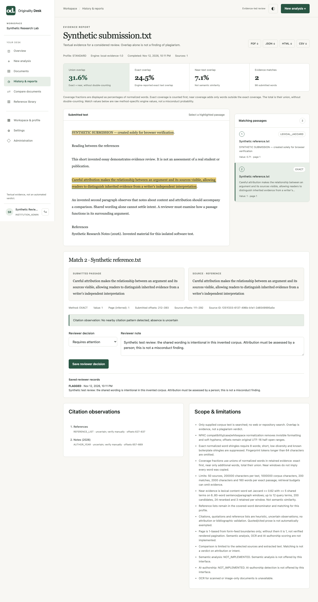
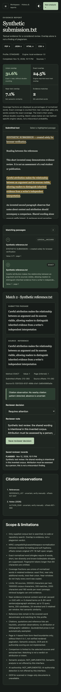

# Actual Java-backed browser captures

Generated by `scripts/e2e/real-browser.cjs` after all checks and cleanup passed. Rerunning the script refreshes these captions, measurements, screenshots, and `metadata.json` together.

**All account names and document contents are synthetic.** These are actual Chromium screenshots of the Java-served application. No API responses, scores, sources, or screenshot pixels were mocked or retouched. The report values were calculated by the real engine on this deliberately overlapping invented corpus; they are not performance, accuracy, or misconduct claims.

## Captures

### landing.png

Public landing, light theme, before any account is created.

Viewport: 1440 × 1000 CSS pixels. Full-page PNG: 1440 × 3113 pixels. Captured 2026-11-12T22:11:17.986Z.


### report.png

Actual STANDARD analysis of two synthetic TXT documents, light desktop theme, with server-persisted reviewer note.

Viewport: 1440 × 1000 CSS pixels. Full-page PNG: 1440 × 2721 pixels. Captured 2026-11-12T22:11:32.310Z.



### mobile.png

The same real synthetic-data report at 390 × 844 CSS pixels, persisted dark theme; navigation opens and closes by keyboard.

Viewport: 390 × 844 CSS pixels. Full-page PNG: 390 × 4376 pixels. Captured 2026-11-12T22:11:32.780Z.



## Measured successful run

- Started: 2026-11-12T22:11:14.715Z; finished: 2026-11-12T22:11:33.445Z.
- 19 targeted checks passed in 18.73 seconds, including startup, captures, and cleanup. Timings describe this one local run, not a benchmark.
- 85 observed API responses (44 browser-generated; others are direct assertions using the same authenticated browser contexts).
- Chromium 147.0.7727.15; Node v20.20.0; darwin/x64.
- Engine: local-evidence-1.0; profile: STANDARD; selected sources: 1; submitted words: 98.
- Actual evidence: 2 matches and 2 citation observations. Exact coverage 24.5%; additional near coverage 7.1%; union 31.6%.
- Observed analysis states: QUEUED → COMPLETED. Intermediate states may complete between polls.
- Real authenticated PDF download: 2891 bytes; Content-Type application/pdf; verified %PDF- header and %%EOF marker. SHA-256: e85f13f0ed2201e640f6a17328592d6e248104819084b387b1beab32955eb483.
- PDF re-upload reached READY: 451 extracted words, 2 pages. DOCX upload reached READY: 36 words; pageCount 0 (DOCX is not rendered/paginated by this extractor).
- Two accounts used separate real sessions/workspaces. Cross-workspace reads, report/PDF/review access, and document deletion returned 404 without changing the first workspace.
- Reviewer decision/note was saved to the server and checked after a full page reload. UI deletion removed the submission and its dependent analysis/report/reviews; remaining documents were deleted and final document/analysis/storage counts were zero.
- Browser runtime errors: 0; observed CSP violations: 0.
- Frontend regression checks verify intact landing markup/navigation targets and no literal null/undefined or raw markup fragments in rendered pages. The verified fixes are in src/main/resources/web/index.html and app.js.
- Cleanup: browser closed; Java stopped gracefully; temporary database, blobs, downloads, Java home/temp, and screenshot staging removed. No credentials or persistent test data are retained.

## Reproduce

Use an already installed Playwright module/browser; the runner does not install dependencies:

```sh
node --test scripts/e2e/fixtures.test.cjs scripts/e2e/markup.test.cjs
node scripts/e2e/real-browser.cjs /absolute/path/to/node_modules/playwright
```

See `scripts/e2e/README.md` for requirements, isolation, timeouts, and the optional jar argument. `metadata.json` records the exact jar and served-asset SHA-256 hashes, original engine fractions, per-check durations, image dimensions/hashes, and cleanup outcome. Synthetic test IDs visible in report evidence are ephemeral identifiers, not credentials.

## Limits

This is a targeted real-Java browser workflow, not an exhaustive end-to-end test of every route, document type, browser, authorization rule, or failure mode. In particular:

- Production HTTPS/reverse proxy behavior
- OCR or scanned PDFs (unavailable)
- Concurrent-load/performance guarantees
- Persistence across a Java server restart
- Every possible file format or failure mode

The PDF/DOCX files contain ordinary selectable text. These results do not demonstrate OCR, scanned-document support, semantic analysis, or AI-authorship detection.
